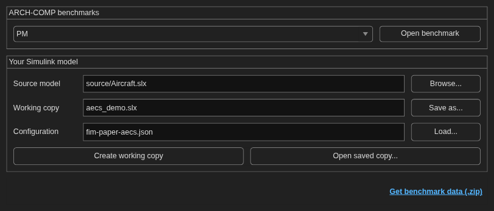
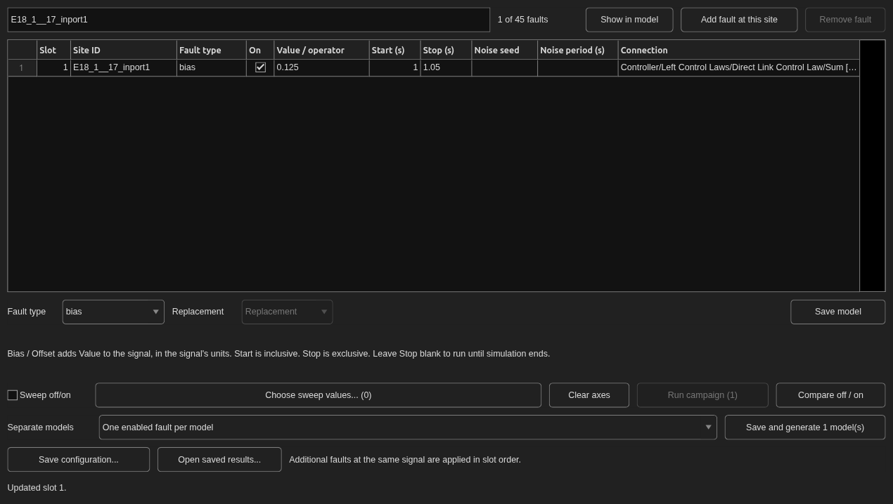
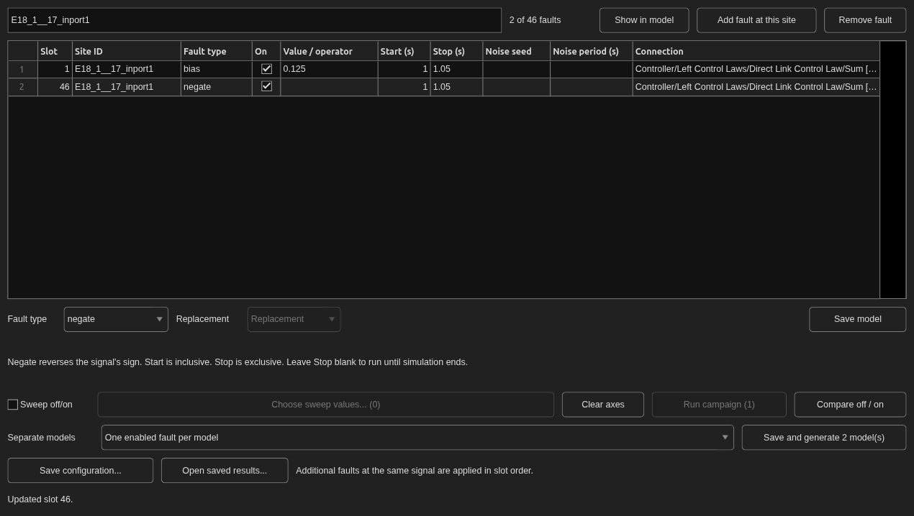
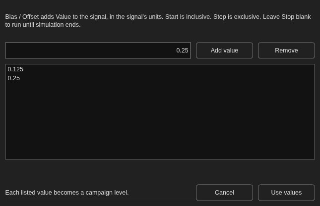
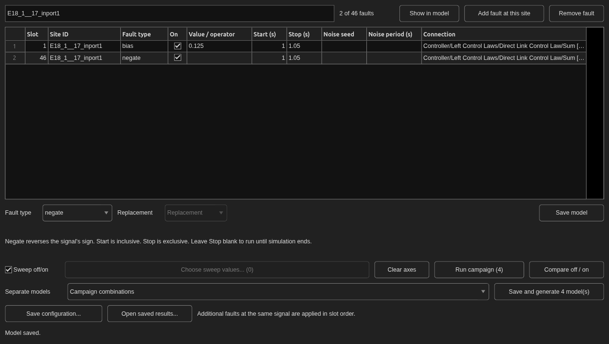
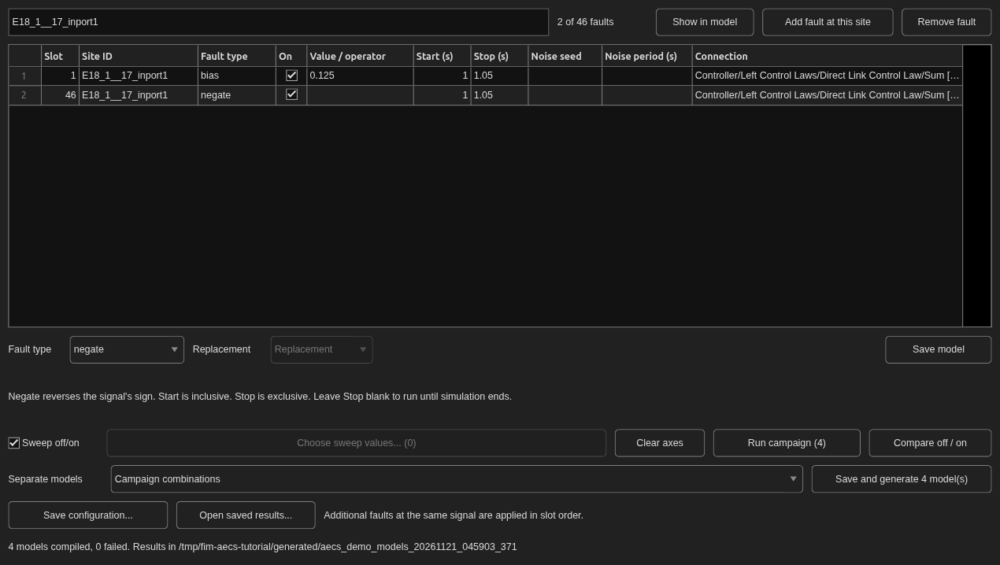

# Stack faults and generate models with the original FIM aircraft

This tutorial uses the Aircraft Elevator Control System (AECS) from the original FIM paper. You will add two faults to the same signal connection, choose their combinations, and generate four separate Simulink models using the FIM Workbench desktop editor. No handwritten JSON or MATLAB commands are needed.

The screenshots show FIM Workbench **2.3.0** running in MATLAB and Simulink **R2026a on Linux**. Folder names and the desktop theme may differ on your computer.

[Back to the main README](../../README.md) · [Original FIM model and reproduction results](../../verification/fim_paper/README.md)

## Before you start

1. Install **MATLAB R2026a or later, Simulink, and Stateflow**. Stateflow is used by this aircraft model.
2. [Download the FIM Workbench 2.3.0 installer](https://github.com/31916/FIMWorkbench/releases/download/v2.3.0/FIMWorkbench-2.3.0.mltbx). Double-click the `.mltbx` file in MATLAB's Files panel and select **Install**.
3. [Download the authors' pinned model archive](https://gitlab.com/api/v4/projects/DrishtiYadav%2Ffimtool/repository/archive.zip?sha=a110acf2b718eab4cdf65f938203f60009fa0510) and extract it. The archive uses commit `a110acf2b718eab4cdf65f938203f60009fa0510`, which matches the supplied configuration.
4. In the extracted archive, locate **`Aircraft_fault_injector/sf_aircraft_model/Aircraft.slx`**. Keep the entire extracted folder: its companion MAT files, MATLAB classes, and other support files are needed when the model opens and simulates.
5. Create a writable folder for your working copy and generated models. Open **FIMWorkbench** from MATLAB's **Apps** tab.

The installer includes the fault configuration. The aircraft and its support files come from the authors' archive. [Source and attribution](../../THIRD_PARTY.md)

## 1. Create a working copy

In the lower **Your Simulink model** section of the launcher:

| Field | What to select |
|---|---|
| **Source model** | Click **Browse...** and select the authors' `Aircraft.slx` at the path above. |
| **Working copy** | Click **Save as...** and choose a new filename, such as `aecs_demo.slx`, in your writable folder. |
| **Configuration** | Click **Load...** and select `fim-paper-aecs.json` from the examples folder that opens. |

Click **Create working copy**. The editor opens with **45 fault slots, all off**. The source model stays unchanged.

The screenshot uses short example paths. Use the file choosers to select the files on your own computer; there is no need to create a folder literally named `source` or to edit the configuration file.

## 2. Enable the first fault

Enter **`E18_1__17_inport1`** in the editor's search box. This selects the connection from **Sum** to **Gain** in `Controller/Left Control Laws/Direct Link Control Law`.

Select the row for **Slot 1** and check **On**. Confirm these values, already supplied by the profile:

| Setting | Value |
|---|---:|
| **Fault type** | `bias` |
| **Value / operator** | `0.125` |
| **Start (s)** | `1` |
| **Stop (s)** | `1.05` |

The bias adds 0.125 to the signal from **1 s inclusive to 1.05 s exclusive**. The search shows one row out of the 45 slots. You can use **Show in model** to locate the selected stage in Simulink.

## 3. Add another fault at the same connection

1. Keep **Slot 1** selected and click **Add fault at this site**.
2. Select the new row, **Slot 46**. A new fault starts off.
3. In the **Fault type** menu below the table, choose **`negate`**.
4. Check **On** for Slot 46. Confirm that its inherited time window is also **1** to **1.05** seconds. Negate has no numerical value, so its value cell is blank.

Both rows have the **same Site ID**. They are two stages on one connection. The remaining 44 slots stay off.

Faults at the same site run in slot order. Here, Bias is followed by Negate. While both are active, the input signal `u` becomes **`−(u + 0.125)`**. Bias and Negate are both fault types from FIM.

## 4. Choose the bias values to generate

1. Select the **Bias row, Slot 1**.
2. Click **Choose sweep values...**.
3. Enter **`0.125`** and click **Add value**.
4. Enter **`0.25`** and click **Add value**.
5. Confirm that both values appear in the list, then click **Use values**.

Leave **Sweep off/on** unchecked for the Bias row. The bias will be active in every generated model, using one of these two values.

## 5. Choose the on/off combinations

Select the **Negate row, Slot 46**, and check **Sweep off/on**. Under **Separate models**, choose **Campaign combinations**.

There are now **2 bias values × 2 Negate states = 4 models**. The button should read **Save and generate 4 model(s)**.

Sweep controls belong to the selected row. Negate has no numerical parameter, so **Choose sweep values...** is disabled while that row is selected. The two values you entered for Bias are still stored.

## 6. Generate the model files

Click **Save and generate 4 model(s)** and choose an existing output directory. Workbench saves the current working copy and creates a new subfolder such as `aecs_demo_models_<timestamp>`.

Wait for **4 models compiled, 0 failed** in the status line. Each generated file is saved, reopened, and compiled. The screenshot shows a sample output directory; your path will be different.

The folder contains these four configurations. Each fault uses the same 1 to 1.05 second window.

| Filename ending | Bias value | Negate | Signal while the faults are active |
|---|---:|---|---|
| `_0001.slx` | 0.125 | Off | `u + 0.125` |
| `_0002.slx` | 0.25 | Off | `u + 0.25` |
| `_0003.slx` | 0.125 | On | `−(u + 0.125)` |
| `_0004.slx` | 0.25 | On | `−(u + 0.25)` |

The full filenames include the working model name and a generated identifier. That identifier and the timestamp change between runs. The first two files have Bias alone; the last two combine Bias and Negate on the same connection.

| Output | Contents |
|---|---|
| Four `.slx` files | Separate editable models with the selected fault settings. |
| `models.csv` | A record of each file's compilation status and any diagnostic. |
| `generation.json` | The settings used for the generation. Workbench writes this automatically. |

## Open a generated model or reuse the setup

In the launcher, choose **Open saved copy...** and select a generated `.slx` file. Search for the same Site ID to inspect its two fault rows. **Compare off / on** runs an all-off baseline and the file's current fault configuration, then opens their waveforms. Model generation itself saves and compiles files; simulations are a separate operation.

To repeat the four-way generation, reopen your original **`aecs_demo.slx` working copy**. It retains the sweep selections. Generated files represent individual cases and have their sweep selections cleared.

You can also use **Save configuration...** to save the settings through a file chooser. Later, select the original `Aircraft.slx` and that saved configuration in the launcher to create another working copy. Keep the working copy, its generated models, and the source/support folders available. Preserve their relative folder layout if you move the project.

## If your screen differs

| Symptom | What to check |
|---|---|
| The expected Site ID is missing, or the initial copy has a different slot count | Start with `Aircraft.slx` from the pinned archive and load the included `fim-paper-aecs.json` profile. |
| A source fingerprint error appears | Select the unmodified `Aircraft.slx` from the linked archive. Its name and version must match the profile. |
| A companion file or class is missing | Extract the entire authors' archive and keep the `sf_aircraft_model` directory together. |
| The generation button shows 3 models | Select **Campaign combinations** under **Separate models**. |
| The button shows 8 models | Check that **Sweep off/on** is selected only for Negate. To reset the sweep selections, click **Clear axes** and repeat steps 4 and 5. |
| A generated case fails | Read its diagnostic in `models.csv`. Successfully completed files remain in the output folder. |
| You are repeating step 1 and the working-copy filename already exists | Choose a new filename, or use **Open saved copy...** to continue editing the existing one. |

## What was verified

The walkthrough used the released 2.3.0 installer and native MATLAB desktop controls. UI callbacks were automated for capture, and the output-directory chooser answer was supplied by the capture harness. The images are actual Workbench window captures; the completion image was recaptured with a sample output path for publication.

The four configurations in the table were reopened and simulated for 10 seconds with the same built-in pilot command and random seed. The logged `Direct Link Control Law/Gain` signal (`s2`) was compared with the expected local bias and sign transformation, including the model's downstream gain of 0.000325. Across **4,000 scalar values**, the maximum absolute difference was **6.78 × 10⁻²¹**. These measurements cover the demonstrated local transformations. [Per-model settings and measurements](../../verification/desktop/aecs-bias-negate.csv)

The source model's SHA-256 was `33774ba8e9eeda22dbcedb3ad960352552984f402d6e559cacf7474fa0180b9c` and remained unchanged. For the original 45-location reproduction and broader regression results, see [FIM paper verification](../../verification/fim_paper/README.md) and [desktop workflow verification](../../verification/desktop/README.md).
